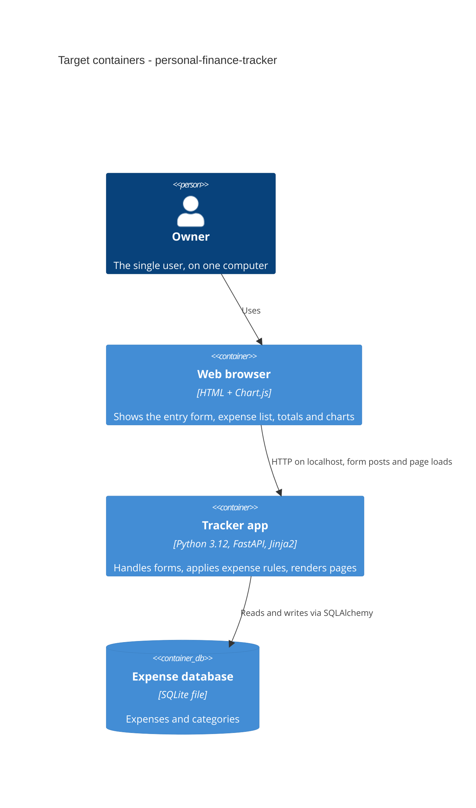

# Architecture map — ai_course (personal-finance-tracker)

> **Greenfield foundation.** This describes the **target baseline** that `scaffold` will create, not code
> that exists yet. Chosen with the owner on 2026-10-31 (guided-default: they accepted the recommended set)
> for the idea in [`idea-brief.md`](idea-brief.md). Refresh with `survey` once the skeleton exists and
> the repo moves past `reflects_commit`.

## Stack

- **Language / runtime:** Python 3.12 (installed locally, `python3 --version` → 3.12.3). Owner decision, see [ADR-0001](adr/0001-build-a-local-python-web-app-with-fastapi-and-server-rendered-pages.md).
- **Web framework:** FastAPI served by Uvicorn, running locally (`http://localhost:8000`).
- **Pages:** Jinja2 templates rendered on the server; plain HTML forms. No SPA framework and no JS build step.
- **Charts:** Chart.js as one static vendored JS file (for spending over time).
- **Data:** SQLite (one file on disk) via SQLAlchemy 2.x; schema migrations with Alembic. See [ADR-0002](adr/0002-store-data-in-a-local-sqlite-file-with-sqlalchemy-and-alembic.md).
- **Build / test / lint:** `pip install -e '.[dev]'` (inside a `.venv`) · `pytest` · `ruff check .` (+ `ruff format`). Packaging in `pyproject.toml`.
- **CI:** GitHub Actions — one workflow that runs lint + tests (the repo has no remote yet; the workflow is ready for one).

## C4 — system as it is

Target baseline (to be scaffolded):

## Module inventory

Single application package, split by layer (dependency direction: `web → domain ← db`; `domain` imports neither).

| Module | Path | Layers | Wired at | Responsibility |
|---|---|---|---|---|
| web | `app/web/` | ports (HTTP + templates) | `app/main.py` (app factory, routers included) | Routes, form parsing/validation, Jinja2 templates in `app/web/templates/`, static files in `app/web/static/` |
| domain | `app/domain/` | domain + app services | called from `app/web/` routes | Expense / category rules (e.g. amount > 0, money in cents), totals and period aggregation |
| db | `app/db/` | infra | session created in `app/db/session.py`, provided to routes via FastAPI dependency | SQLAlchemy models + repository functions; the only layer that touches SQLite |
| migrations | `migrations/` | infra | `alembic.ini` | Alembic environment + versioned revisions |
| tests | `tests/` | — | `tests/conftest.py` | `tests/unit/` (domain, no DB) and `tests/integration/` (app + temp SQLite) |

## Conventions (cited — the rules a new feature must match)

No code exists yet, so these are **decided rules** that `scaffold` will materialize. The cited files are the targets it creates.

- **Module wiring / registration:** each feature area gets an `APIRouter` in `app/web/<area>.py`, included in the app factory `create_app()` in `app/main.py` (target).
- **Error handling:** invalid form input → re-render the same page with HTTP 422 and a message beside each bad field (no JSON error envelope; this is an HTML app). Domain rule violations raise a `DomainError` subclass from `app/domain/errors.py` (target), which the web layer turns into field messages. Unknown IDs → 404 page.
- **Money:** amounts are stored and computed as **integer minor units (cents)** and only formatted for display. One currency, per the brief. Never use `float` for money.
- **Dates:** an expense has the date it happened (`date`, chosen by the user, defaults to today) and a `created_at` timestamp.
- **IDs:** SQLite `INTEGER PRIMARY KEY` auto-increment. This is deliberately simple for a single user on one machine, instead of the generic time-sortable-ID default.
- **Persistence / DB access:** only `app/db/` imports SQLAlchemy; routes get a session through a FastAPI dependency (`get_session` in `app/db/session.py`, target). Repository functions return plain domain objects, and the DB stores data only (no triggers or stored logic).
- **Migrations:** Alembic, `migrations/versions/<rev>_<snake_case_message>.py`, autogenerate then hand-review; each revision has a working `downgrade()`. Run with `alembic upgrade head`.
- **Tests:** pytest. Unit tests in `tests/unit/` exercise `app/domain/` with no DB. Integration tests in `tests/integration/` use FastAPI `TestClient` against a temporary SQLite file migrated to `head` (a real DB; no Docker needed). Fixtures live in `tests/conftest.py` (target).
- **Inter-module communication:** direct function calls within one process. No events, queues, or HTTP between modules.
- **Lint / format:** ruff (`ruff check .`, `ruff format`), configured in `pyproject.toml`.
- **UI / styling:** server-rendered Jinja2 with a shared `base.html` layout and one hand-written stylesheet `app/web/static/app.css` (target). Detail below.

## Datastores

| Store | Engine | Accessed via | Notes |
|---|---|---|---|
| Expense database | SQLite 3 (Python's built-in `sqlite3` driver) | SQLAlchemy 2.x in `app/db/` | One file, default `./data/tracker.db` (path set by env var `TRACKER_DB_PATH`); `data/` is gitignored. Backing up = copying the file |

## Frontend / UI foundation

Decided, not yet built. New UI work composes these pieces instead of adding another styling system.

- **Component library / design system:** none third-party. Reusable Jinja2 macros in `app/web/templates/_macros.html` (target) for form fields with error display, buttons, and tables.
- **Design tokens:** CSS custom properties (colors, spacing, font) at the top of `app/web/static/app.css` (target).
- **Styling approach:** plain CSS, one stylesheet; no Tailwind and no CSS-in-JS.
- **Shared primitives:** `base.html` layout with nav, plus form-field / button / table macros (targets).
- **State / data-fetching:** none client-side. Full-page form posts with redirect-after-POST. Chart data is embedded in the page as JSON for Chart.js.
- **Closest UI precedent:** none yet. The first screen built by `scaffold` (a placeholder home page) becomes the precedent.

## Where things live / closest precedents

- A new feature area (e.g. expenses, categories, reports) → `app/web/<area>.py` router + `app/web/templates/<area>/` + rules in `app/domain/<area>.py` + persistence in `app/db/` + a migration in `migrations/versions/`. There's no precedent yet; the first feature sets it.
- A new screen → extends `base.html`, uses the `_macros.html` primitives and `app.css` tokens.

## Constraints & known tech-debt

- **Single user, local only** (brief): no authentication, no sign-up, no multi-device sync. The server binds to `127.0.0.1` only, so it must not be exposed to a network as-is.
- **One currency, expenses only** (brief §5): there's no currency or income model. Adding either later is a schema change.
- **No required technology** (brief §4). The AWS Lambda sketch from the former `mermaid.test` isn't a constraint.
- **No git remote yet:** the CI workflow won't run until the repo is pushed to GitHub.

## Reconciliation with the authored architecture doc

There's no authored architecture doc, so this map is the current reference.
